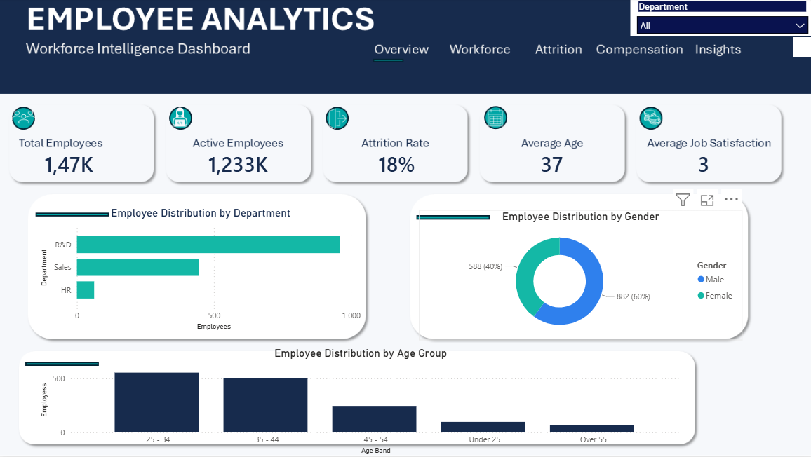

# 📊 Power BI Employee Analytics Dashboard

## Project Overview

An interactive Human Resources (HR) analytics dashboard developed using Microsoft Power BI to analyse employee demographics, workforce distribution, employee attrition and compensation data.

The project demonstrates practical data analysis skills, including data preparation, data modelling, DAX calculations, data visualisation and the presentation of workforce insights through an interactive dashboard.

## Project Objectives

- Analyse workforce demographics and employee distribution.
- Examine employee distribution across departments, job roles and education levels.
- Explore employee attrition patterns across different workforce categories.
- Analyse compensation trends across departments and job roles.
- Present workforce information through interactive visualisations and key performance indicators (KPIs).

## Tools & Technologies

- **Microsoft Power BI:** Dashboard development and data visualisation.
- **Power Query:** Data cleaning, transformation and preparation.
- **DAX:** Measures, calculations and KPI development.
- **Microsoft Excel:** Dataset management and preparation.

## Dashboard Pages

### 1. Overview

Provides a summary of the workforce through key performance indicators and visualisations showing employee distribution by department, gender and age group.

### 2. Workforce Analysis

Explores employee distribution across job roles, education levels and education fields to provide an overview of the workforce structure.

### 3. Attrition Analysis

Examines employee turnover, including attrition patterns across age groups and job roles, alongside key attrition-related metrics.

### 4. Compensation Analysis

Explores average monthly income across departments and job roles using compensation data created for portfolio demonstration purposes.

### 5. Key Insights & Recommendations

Brings together workforce analysis through visualisations highlighting attrition by department, average monthly income by education level and workforce age distribution.

## Dataset

The project uses an Employee Statistics dataset provided as part of academic coursework, containing 1,470 employee records.

The dataset includes information such as:
- Employee number
- Gender and age
- Department and job role
- Education level and education field
- Business travel
- Job satisfaction
- Employee attrition status

An additional compensation dataset containing simulated monthly income figures was created and matched to the employee records using employee numbers.

## Key Skills Demonstrated

- Data cleaning and transformation
- Data modelling and relationships
- DAX measures and calculated metrics
- Exploratory data analysis
- KPI development
- Interactive dashboard design
- Data visualisation
- Workforce and attrition analysis

## Data Disclaimer

The original Employee Statistics dataset was provided for academic learning purposes. Compensation figures were separately simulated for portfolio demonstration and do not represent actual employee salaries.

## Project Files

- `Employee_Analytics_Dashboard.pbix` – Power BI report file.
- `Screenshots/` – Dashboard page screenshots.
- `Data/` – Datasets used in the project.
