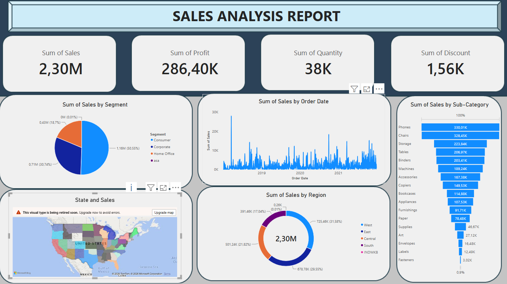

# 📊 Power BI Sales Analysis Report

## Project Overview

A one-page sales analysis report developed using Microsoft Power BI. The project uses a retail sales dataset to explore sales performance, profitability, product performance, customer segments and regional sales distribution.

This project was completed as a guided learning exercise using a tutorial by Sai Kumar on YouTube.

## Project Objectives

- Summarise overall sales performance using key performance indicators.
- Examine sales across different customer segments.
- Compare sales performance across states and regions.
- Analyse sales trends over time.
- Explore sales across product sub-categories.
- Present business data through clear visualisations.

## Tools & Technologies

- **Microsoft Power BI:** Report development and data visualisation.
- **Power BI built-in aggregations:** Summarising sales, profit, quantity and discount data.

## Report Overview

The report contains four KPI cards:

- Sum of Sales
- Sum of Profit
- Sum of Quantity
- Sum of Discount

It also includes five visualisations:

- Sales by Customer Segment
- Sales by State
- Sales by Order Date
- Sales by Region
- Sales by Sub-Category

 ### Report Screenshot

## Dataset Description

The retail sales dataset contains information about orders, customers, products, shipping details and sales performance.

Key fields include:
- Order ID and Order Date
- Customer Name and Segment
- Country, State and Region
- Product Category and Sub-Category
- Sales, Quantity, Discount and Profit

## Skills Demonstrated

- Power BI report development
- Data visualisation
- KPI presentation
- Sales performance analysis
- Regional and product analysis
- Business data interpretation

## Tutorial Acknowledgement

This project was completed as a guided learning exercise, following a Power BI sales analysis tutorial by Sai Kumar on YouTube. The tutorial provided guidance during the development of the report.

## Project Files

- `Sales_Analysis_Report.pbix` – Power BI report file.
- `Screenshots/` – Screenshot of the completed report.
